Flare is your Zell coach. With the Flare app for Microsoft Teams you can ask it things without opening Zell: how your calls went, who on your team needs help, what the playbook says.

<Note>
  Want to import Teams meeting recordings into Zell instead? That's a different integration: see [Connect Microsoft Teams](/guides/teams-integration).
</Note>

Setup happens once per company:

1. Your IT team adds the Flare app to Teams.
2. A Zell admin connects your company.

After that, everyone with a Zell account can use Flare in Teams.

## Add the app to Teams

Zell sends you a `.zip` file with the Flare app. Don't unzip it.

**For the whole company:** in the [Teams admin center](https://admin.teams.microsoft.com), go to **Teams apps** → **Manage apps** → **Upload new app** and pick the file.

**Just for you, to try it first** (only works if your company allows custom apps):

<Steps>
  <Step title="Open Manage your apps">
    Click **Store** in the left bar, then the gear at the top right. In older versions of Teams, Store is called **Apps**.

    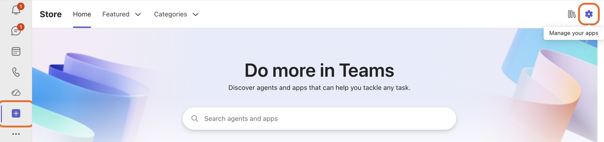
  </Step>

  <Step title="Upload the app">
    Click **Upload an app**.

    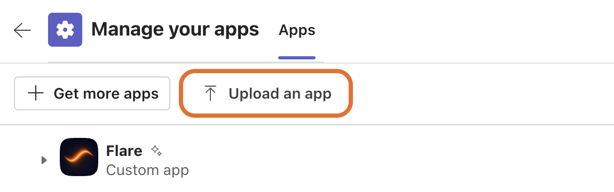
  </Step>

  <Step title="Pick the file">
    Click **Upload a custom app** and pick the `.zip` file.

    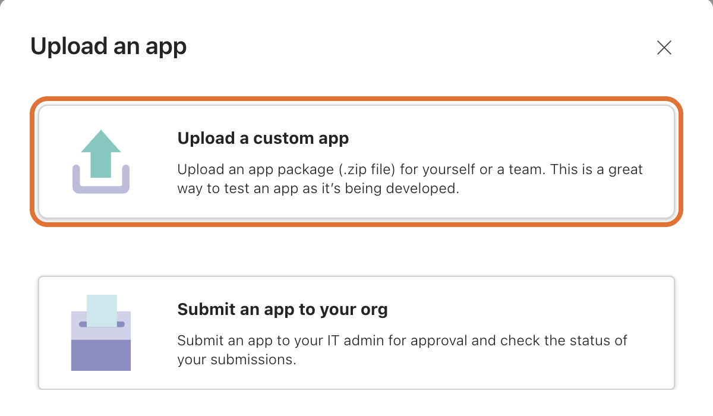
  </Step>

  <Step title="Add Flare">
    Click **Add**. Flare now shows up in your chat list.

    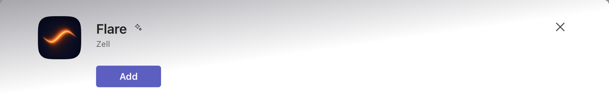
  </Step>
</Steps>

## Connect Zell

A Zell admin does this once for the whole company.

<Steps>
  <Step title="Say hi to Flare">
    Open Flare in Teams and send it any message. Flare answers with a **Connect Zell** button. Click it.

    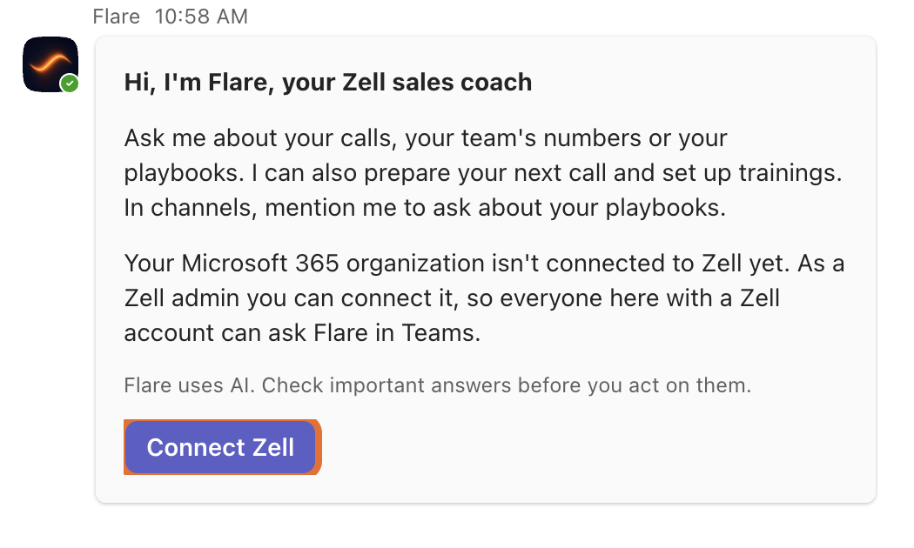
  </Step>

  <Step title="You're connected">
    Flare confirms the connection. Everyone at your company with a Zell account can now use Flare in Teams.

    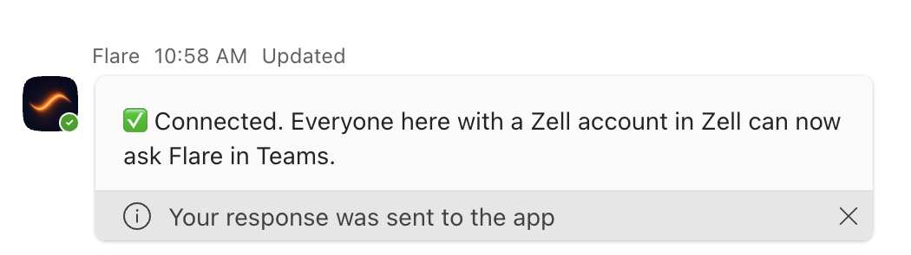
  </Step>
</Steps>

<Warning>
  Flare finds people by email, so it has to be the same in Teams and in Zell. If it isn't, Flare shows a **Link my Zell account** button. Click it and sign in to Zell once.
</Warning>

To check or remove the connection, open **Settings** → **Tenant Settings** → **Integrations** → **Microsoft Teams** in Zell. You can disconnect there.

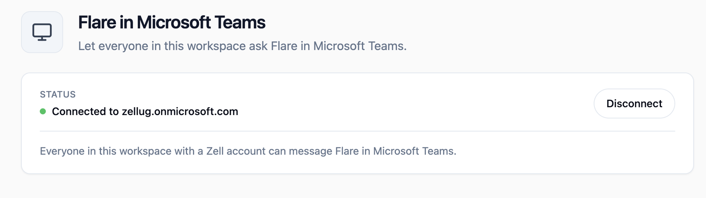

## Ask Flare

Open Flare from your chat list and ask the way you'd ask a coworker. For example:

- "How did my calls go last week?"
- "Help me prep my next discovery call."
- "Which reps need coaching most?"
- "What does our playbook say about price objections?"

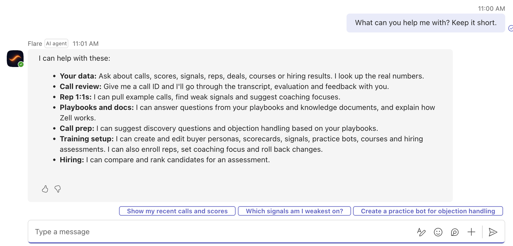

- Click a suggestion under the answer to keep going.
- Thumbs up or down tells us if the answer helped.
- Ask follow-ups in the same chat. Flare remembers what you said.
- Click **Stop** to cut an answer short.

## Channels and group chats

First add Flare to the channel: find Flare in **Store**, click **Add**, then pick the channel and click **Go**.

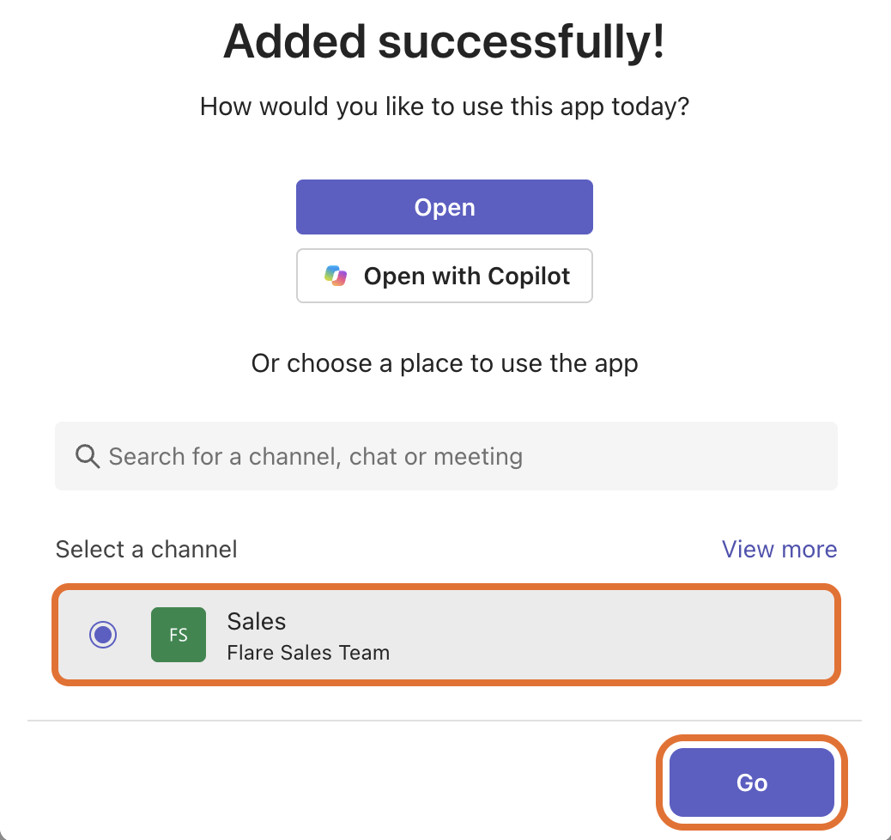

Then there are two ways to ask.

### @Flare: everyone sees the answer

Type **@Flare**, pick Flare, then your question. Flare replies in the thread.

Everyone in the channel can read the answer, so Flare only talks about playbooks and how Zell works there. For your own calls and numbers, use your private chat with Flare.

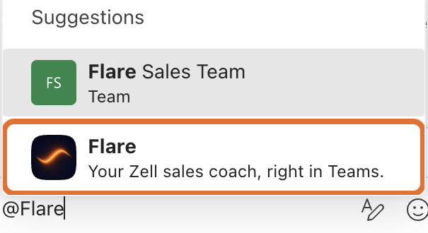

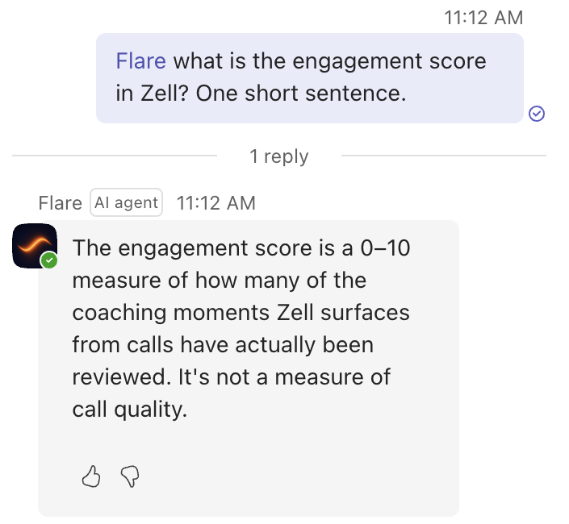

### /flare: only you see the answer

Type **/flare** and pick the one that says **Ask Flare privately**. Only you see the answer. Want others to see it? Click **Share to channel**.

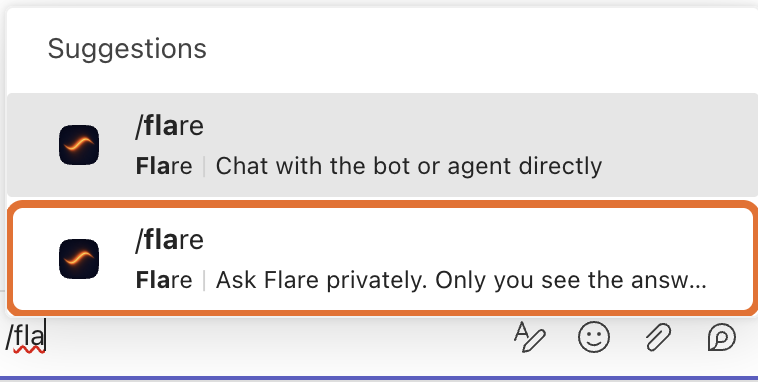

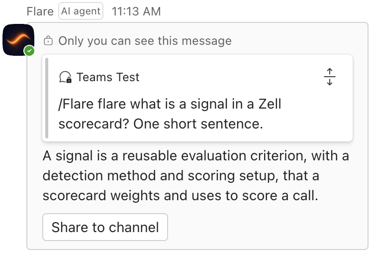

## If something doesn't work

<AccordionGroup>
  <Accordion title="Flare says it couldn't match your Microsoft account">
    Your company isn't connected yet (see [Connect Zell](#connect-zell)), or your Teams email is different from your Zell email. Click **Link my Zell account** if you see it.

    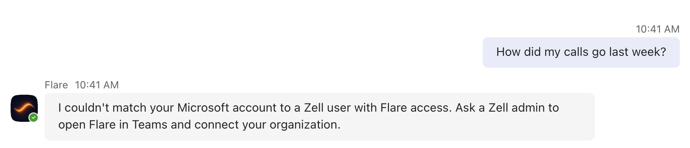
  </Accordion>

  <Accordion title="You can't find Flare">
    Click **•••** in the left bar. If Flare isn't there, ask your IT team to add it (see [Add the app to Teams](#add-the-app-to-teams)).

    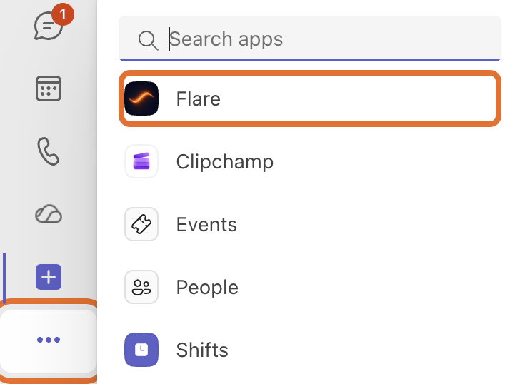
  </Accordion>

  <Accordion title="Flare says only an admin can connect">
    Connecting needs someone who is an admin in Zell.
  </Accordion>

  <Accordion title="Flare can't open your file">
    Paste the text into your message instead.
  </Accordion>

  <Accordion title="You're not sure what to ask">
    Type **help** in your chat with Flare.
  </Accordion>
</AccordionGroup>

<Note>
  Flare uses AI and can get things wrong. Check anything important before you act on it.
</Note>
