The live coach sits on top of your call. It listens to both sides, shows you what to say when it can help, and ticks off your playbook as you go.

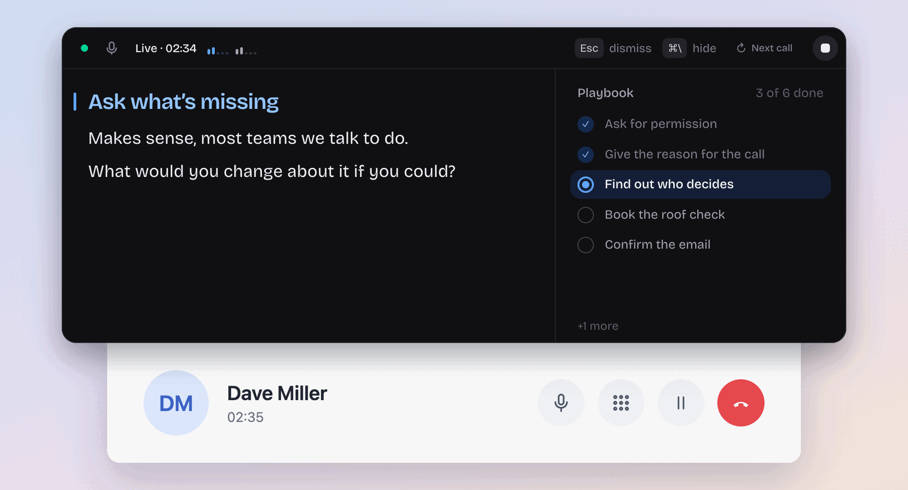

It's part of **Zell Assistant**, the Zell app for Mac and Windows, and works with any calling app on your computer.

## Set it up

<Steps>
  <Step title="Download the app">
    Open the [download page](https://github.com/GetZell/zell-desktop-releases/releases/latest) and pick the file for your computer.

    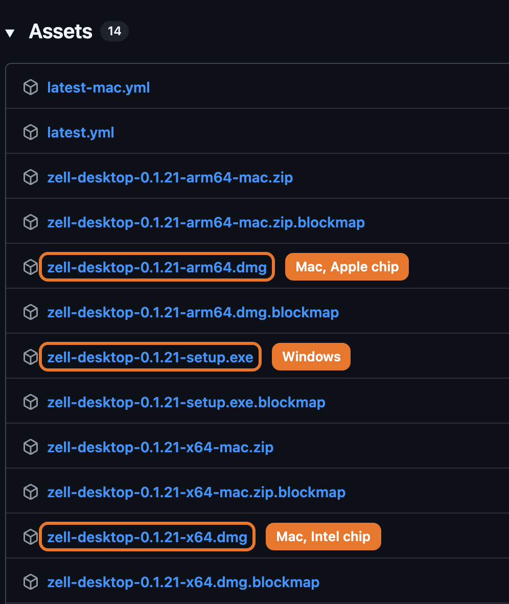

    Not sure? On your Mac, click the Apple logo → **About This Mac**. M1 or higher is an Apple chip. You need macOS 14.2 or newer.
  </Step>

  <Step title="Install it">
    **Mac:** open the file and drag Zell Assistant into **Applications**.

    **Windows:** open the file. If Windows shows a warning, click **More info** → **Run anyway**.
  </Step>

  <Step title="Sign in">
    Click **Sign in with Zell**. Your browser opens: sign in there, then go back to the app.

    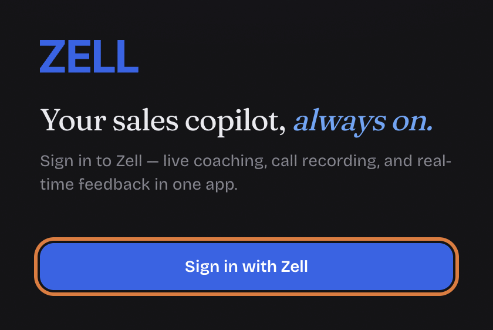
  </Step>
</Steps>

The app isn't in the Dock. Find the **Z** in your Mac's menu bar, or next to the clock on Windows.

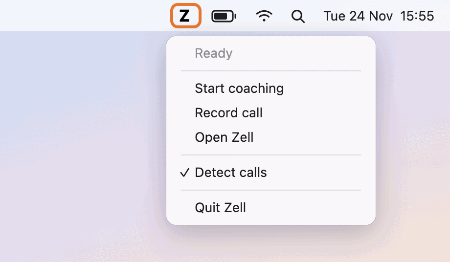

## Start a call

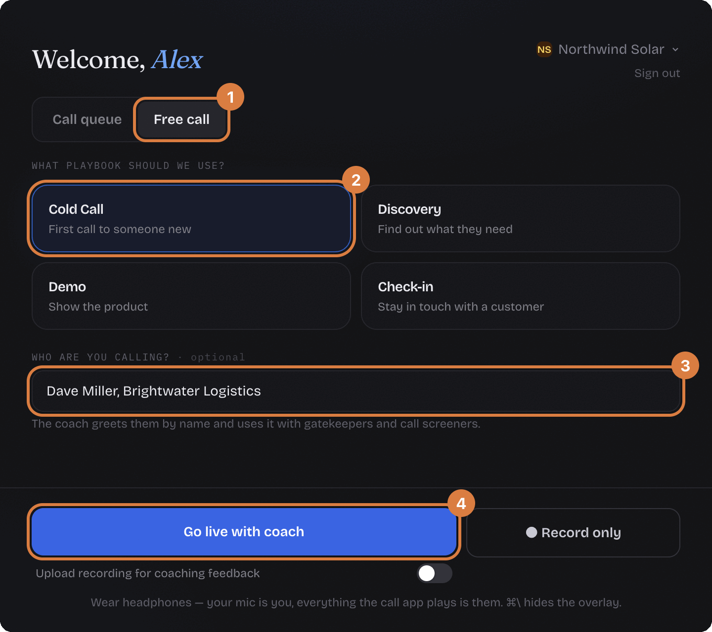

1. Open **Free call**.
2. Pick the playbook for this call.
3. Type who you're calling, if you know.
4. Click **Go live with coach**, then call the way you always do.

The first time, your Mac asks for the microphone (you) and system audio (the other person). Allow both.

<Warning>
  Wear headphones. Otherwise your microphone hears the other person too, and the coach mixes up who said what.
</Warning>

On a Mac, Zell also notices when a call starts. Click the notification and the coach starts with your last playbook.

## During the call

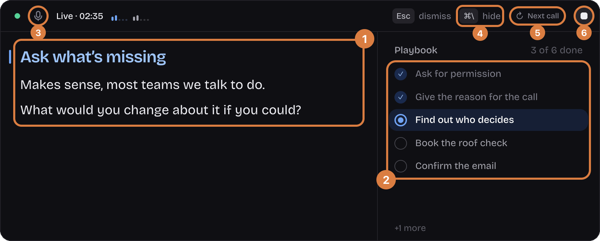

1. **Your tip**: the move in blue, then a line you can say.
2. **Your playbook**: done steps get a tick, the next one is highlighted.
3. **Mute**: the coach stops hearing you. The other person still hears you.
4. **Hide**: press `⌘\` (`Ctrl+\` on Windows). Press it again to bring the coach back.
5. **Next call**: saves this call and starts the next one with the same playbook.
6. **Stop**: ends the coaching. You hang up in your calling app.

Tips only come up when the coach can help. Some calls get a few, some get none. Press `Esc` to close a tip. Drag the coach to move it.

<Warning>
  If you share your whole screen, the other person can see the coach. Share one window instead, or hide the coach.
</Warning>

## End the call

When the call seems to be over, Zell asks. It never ends it for you.

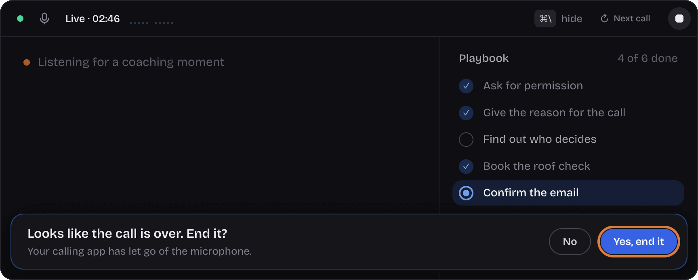

Then you see how it went:

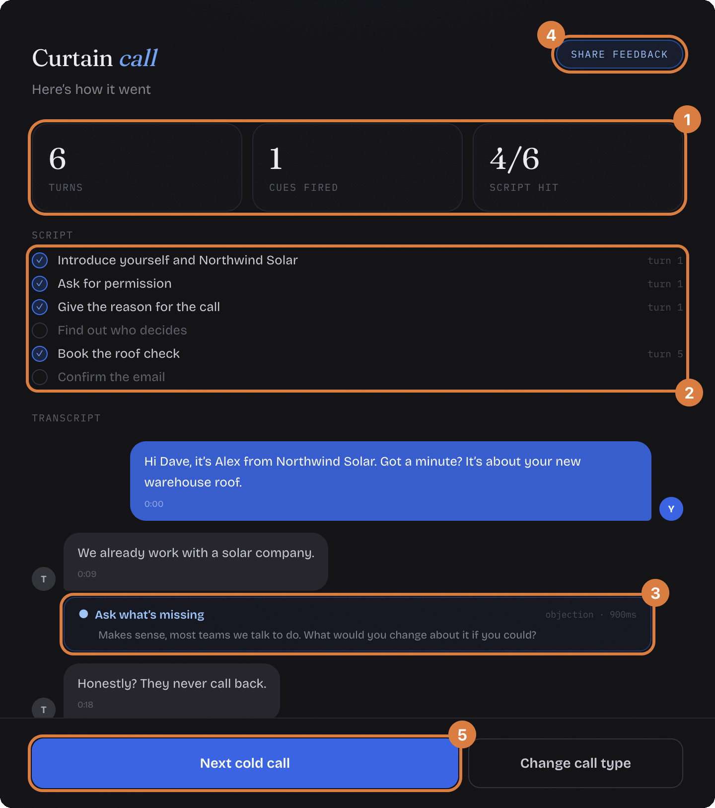

1. **Numbers**: cues fired is how many tips you got, script hit is how many playbook steps you covered.
2. **Script**: what you covered and what you missed.
3. **Transcript**: with every tip where it came up.
4. **Share feedback**: tell us if the coach helped. We get your score, the transcript and the tips.
5. **Next call**: same playbook again.

You see this page once, right after the call.

## Call queue

Do you have call tasks in HubSpot? **Call queue** lines up the ones due today or earlier. Zell dials with Aircall, coaches you, and saves the result in HubSpot.

A Zell admin connects HubSpot once, in **Settings** → **Tenant Settings** → **Integrations**. Your email has to be the same in Zell, HubSpot and Aircall.

Sign in to Aircall once, then quit the Aircall app so calls don't ring twice.

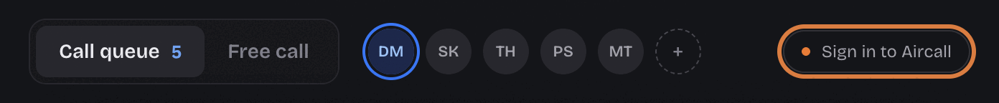

### Make the call

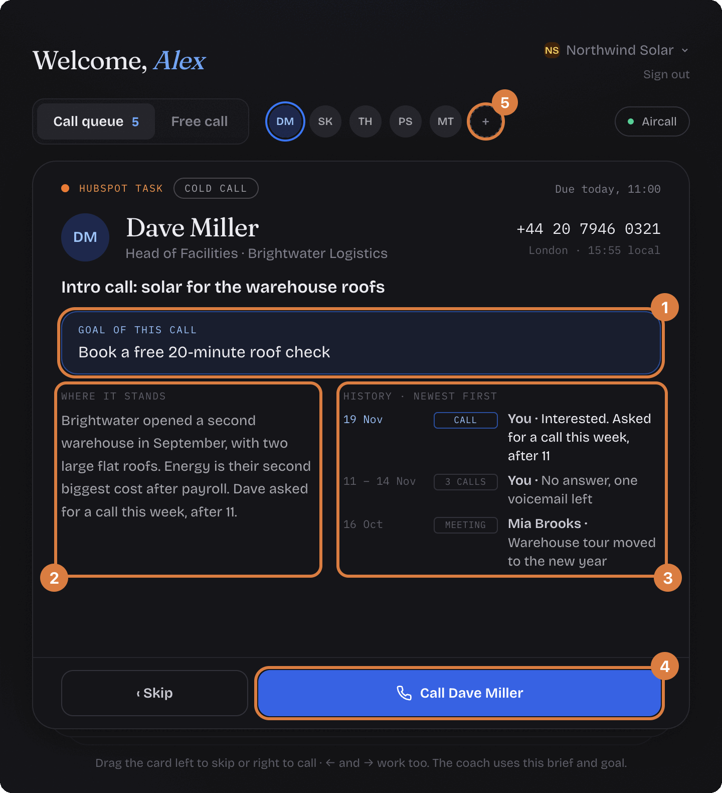

1. **Goal**: what you want from this call.
2. **Where it stands**: the story so far.
3. **History**: earlier calls, meetings and notes.
4. **Call**: Aircall dials and the coach starts. Without Aircall, your computer's phone app dials.
5. **Add people**: call your own list too.

On Aircall calls, the mute button also mutes you for the other person, and stop hangs up.

### Save the result

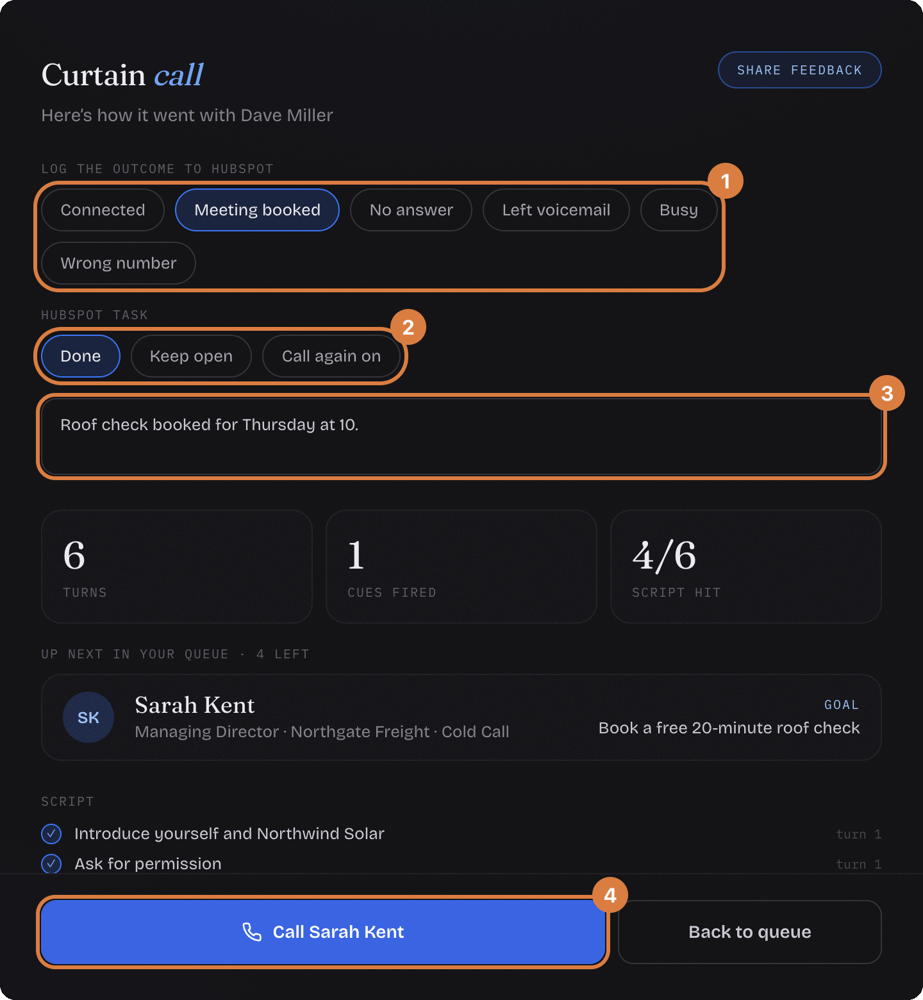

1. Pick the outcome.
2. Close the task, keep it open, or pick a day to call again.
3. Add a note for the contact, if you like.
4. Call the next person. Zell saves everything to HubSpot. The outcome can take ten minutes to show up there.

### Call your own list

Click **+** and pick a CSV file with one person and phone number per row. Everything else in the file, like the company or a goal, goes on the card.

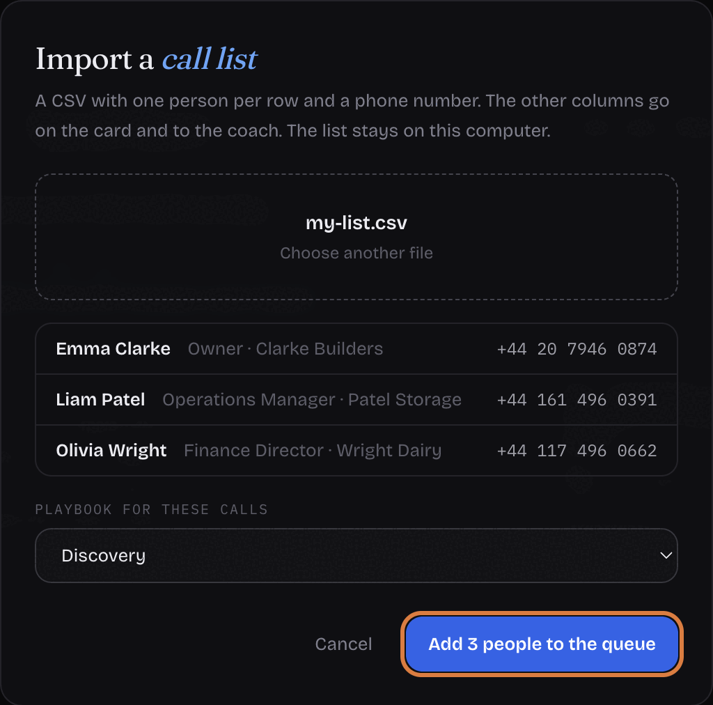

## Record a call

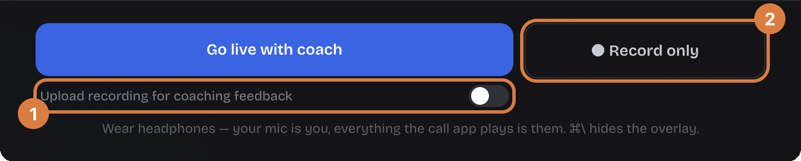

1. Turn this on to also send the recordings of your coached calls to Zell.
2. Record without the coach. The recording goes to Zell when you stop.

## If something doesn't work

<AccordionGroup>
  <Accordion title="The coach doesn't hear me, or the other person">
    Look at the two small meters next to the timer: blue is you, gray is the other person. If one never moves on a Mac, open **System Settings** → **Privacy & Security**, turn on Zell Assistant under **Microphone** and **Screen & System Audio Recording**, then quit and reopen Zell.
  </Accordion>

  <Accordion title="The dot at the top left is orange">
    The connection dropped and Zell is getting it back. If it says **stream lost**, stop and start again.
  </Accordion>

  <Accordion title="There's no playbook to pick">
    Your company doesn't have one for the live coach yet. Ask your Zell contact.
  </Accordion>

  <Accordion title="I can't find the coach">
    It may be hidden: press `⌘\` (`Ctrl+\` on Windows). Or open Zell Assistant again, like any other app.
  </Accordion>

  <Accordion title="I can't sign in to Aircall">
    Aircall's Google sign-in doesn't work inside Zell. Click **Call**, then **Can't sign in? Use the Aircall app**.
  </Accordion>

  <Accordion title="HubSpot doesn't know me, or has to be reconnected">
    Ask a Zell admin. Either no HubSpot user has your Zell email, or HubSpot has to be connected again in **Integrations**. Until then you can call your own list.
  </Accordion>
</AccordionGroup>

<Note>
  Tips are written by AI and can be wrong. Check anything important before you say it.
</Note>
