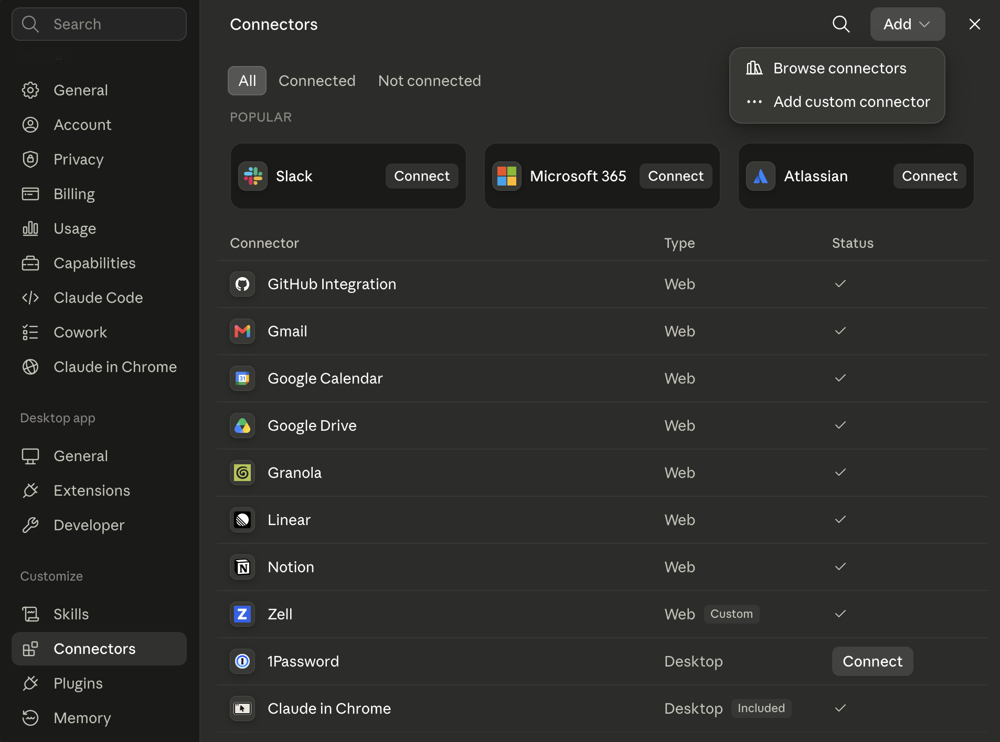
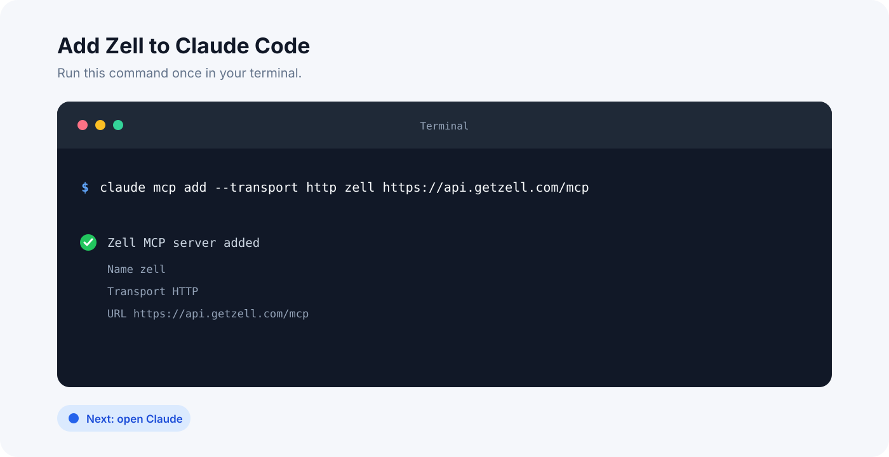
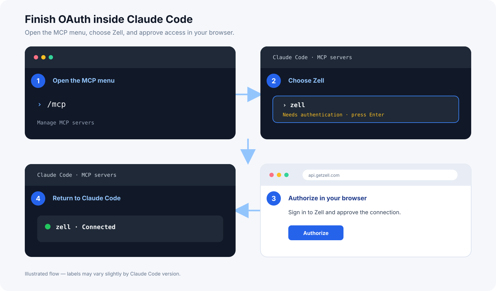

The Zell MCP connects Claude, ChatGPT, or Codex to your Zell workspace. All clients use this remote MCP endpoint:

```text
https://api.getzell.com/mcp
```

Authentication uses OAuth, so you do not need to create or copy an API key.

## Which client are you using?

<CardGroup cols={2}>
  <Card title="Claude Desktop" icon="desktop" href="#claude-desktop">
    Add Zell as a custom connector in the Claude app.
  </Card>

  <Card title="ChatGPT" icon="sparkles" href="#chatgpt">
    An admin adds Zell once, then each member installs it.
  </Card>

  <Card title="Claude Code" icon="terminal" href="#claude-code">
    Install Zell from your terminal and authorize it in a session.
  </Card>

  <Card title="Codex" icon="code" href="#codex">
    Add and authorize Zell with the Codex CLI.
  </Card>
</CardGroup>

## Claude Desktop

<Steps>
  <Step title="Choose your setup path">
    <Tabs>
      <Tab title="Individual plan">
        Open the Claude desktop app and go to **Settings** → **Connectors**. Click **Add** in the upper-right corner, then select **Add custom connector**.

        
      </Tab>

      <Tab title="Team or Enterprise owner">
        An **Owner** or **Primary Owner** must first add Zell for the organization. Go to **Organization settings** → **Connectors**, click **Add**, then select **Custom** → **Web**.
      </Tab>

      <Tab title="Team or Enterprise member">
        Ask an **Owner** or **Primary Owner** to add Zell for your organization. After they add it, go to **Customize** → **Connectors**, find **Zell** with the **Custom** label, and click **Connect**.

        Skip the next step because your organization owner has already entered the server URL.
      </Tab>
    </Tabs>
  </Step>

  <Step title="Enter the Zell details">
    If you are using an individual plan or adding Zell as an organization owner, use **Zell** as the connector name and enter this URL as the remote MCP server URL:

    ```text
    https://api.getzell.com/mcp
    ```

    Save or connect the custom connector.
  </Step>

  <Step title="Authorize Zell">
    On Team and Enterprise plans, every user—including the owner who added Zell—must go to **Customize** → **Connectors**, find **Zell**, and click **Connect**.

    Sign in to Zell in the browser window that opens and approve the connection.
  </Step>

  <Step title="Confirm the connection">
    Return to the connector list: **Settings** → **Connectors** on an individual plan or **Customize** → **Connectors** on a Team or Enterprise plan. Zell should appear as a custom web connector with a connected status.

    <Check>Zell is now ready to use in Claude Desktop.</Check>
  </Step>
</Steps>

For more information about plan permissions, see [Anthropic's custom connector guide](https://support.claude.com/en/articles/11175166-get-started-with-custom-connectors-using-remote-mcp).

## ChatGPT

<Info>
  Custom MCP apps are available on ChatGPT web for Business, Enterprise, and Edu workspaces. Pro accounts can connect custom MCP servers with read-only access. You do not need to turn on Developer Mode.
</Info>

Setting up Zell in ChatGPT takes two parts. A workspace admin or owner adds Zell once for the whole workspace. Then **every member installs Zell in their own account** and signs in with their own Zell login.

<Steps>
  <Step title="Admin: add Zell as a custom MCP server">
    A workspace admin or owner opens [ChatGPT Plugins](https://chatgpt.com/plugins), clicks the **plus** button, and selects **Add custom MCP server**. Enter these details:

    | Field | Value |
    | --- | --- |
    | Name | `Zell` |
    | Connection | `https://api.getzell.com/mcp` |
    | Authentication | OAuth |

    Check **I understand and want to continue**, then select **Create as a plugin**. Sign in to Zell when prompted and review the tools ChatGPT found.
  </Step>

  <Step title="Admin: publish Zell for the workspace">
    Publish the Zell app so members can see it. In the [Admin Console](https://admin.openai.com), select your workspace, open **Plugins**, and publish the Zell draft. On Enterprise and Edu, you can also choose which actions and groups have access before you publish.

    If you cannot create or publish apps, ask your ChatGPT workspace owner to check the **Create plugins with MCPs** permission in Workspace settings.
  </Step>

  <Step title="Every member: install Zell in your own account">
    Adding Zell to the workspace does not connect it for each person. Every member, including the admin who added it, must do this once:

    1. In ChatGPT, go to **Settings** → **Plugins** and select **Zell**.
    2. Select **Install plugin**, then **Connect**.
    3. Sign in to Zell in the window that opens and approve the connection.
  </Step>

  <Step title="Use Zell in a chat">
    Start a new chat, type **@**, and select **Zell**. You can also open the **plus** menu and choose Zell. Review tool calls before you approve them.

    <Check>Zell is now ready to use in ChatGPT.</Check>
  </Step>
</Steps>

For current availability and permissions, see [OpenAI's guide to connecting custom MCP servers](https://help.openai.com/en/articles/12584461-developer-mode-apps-and-full-connectors-in-chatgpt-beta).

## Claude Code

<Steps>
  <Step title="Add the Zell MCP server">
    Run this command in your terminal:

    ```bash
    claude mcp add --transport http zell https://api.getzell.com/mcp
    ```

    This saves Zell as an HTTP MCP server named `zell` in Claude Code.

    
  </Step>

  <Step title="Open Claude Code">
    Start a new Claude Code session, or return to one that is already running.
  </Step>

  <Step title="Start OAuth from the MCP menu">
    Enter the following slash command inside the Claude Code session:

    ```text
    /mcp
    ```

    Select **zell** and follow the authentication prompt. Claude Code opens your browser so you can sign in to Zell and authorize the connection.

    
  </Step>

  <Step title="Confirm the connection">
    Return to Claude Code after authorization. Open `/mcp` again and confirm that **zell** is connected.

    <Check>Zell is now ready to use in Claude Code.</Check>
  </Step>
</Steps>

## Codex

Add the Zell MCP server:

```bash
codex mcp add zell --url https://api.getzell.com/mcp
```

Then start OAuth login:

```bash
codex mcp login zell
```

Complete the authorization in the browser window that opens. When you return to Codex, the Zell MCP server is ready to use.

## Troubleshooting

<AccordionGroup>
  <Accordion title="Zell does not appear in ChatGPT">
    Check that a workspace admin has added and published Zell. Then go to **Settings** → **Plugins**, select **Zell**, and select **Install plugin**. If Zell shows **Disabled by admin**, ask your workspace admin to turn it on.
  </Accordion>

  <Accordion title="ChatGPT does not show Add custom MCP server">
    Confirm that you are using ChatGPT on the web with a Business, Enterprise, or Edu account. Only admins and owners, or members with the **Create plugins with MCPs** permission, can add custom MCP servers.
  </Accordion>

  <Accordion title="ChatGPT cannot scan the Zell tools">
    Confirm that the MCP server URL is exactly `https://api.getzell.com/mcp`, refresh the Zell app from the workspace app settings, and complete the OAuth prompt again. If authorization expired, reconnect from **Settings** → **Plugins** or recreate the app.
  </Accordion>

  <Accordion title="Zell does not appear in Claude Desktop">
    On an individual plan, add the custom connector again and confirm that the URL is exactly `https://api.getzell.com/mcp`. On Team and Enterprise plans, ask an Owner or Primary Owner to check that Zell is present under **Organization settings** → **Connectors**. After it is added there, users can find Zell under **Customize** → **Connectors**.
  </Accordion>

  <Accordion title="Claude Code does not show Zell in /mcp">
    Run the `claude mcp add` command again and check that the server name is `zell`. Then restart your Claude Code session and open `/mcp`.
  </Accordion>

  <Accordion title="The browser did not open">
    Open Zell from the Claude Desktop connector list or `/mcp` in Claude Code and start the connection again. In Codex, rerun `codex mcp login zell`. Follow any authorization URL displayed if the browser still does not open automatically.
  </Accordion>

  <Accordion title="Authorization expired or was revoked">
    Start the OAuth flow again from **Settings** → **Plugins** in ChatGPT, the Claude Desktop connector list, `/mcp` in Claude Code, or `codex mcp login zell` in Codex.
  </Accordion>
</AccordionGroup>
